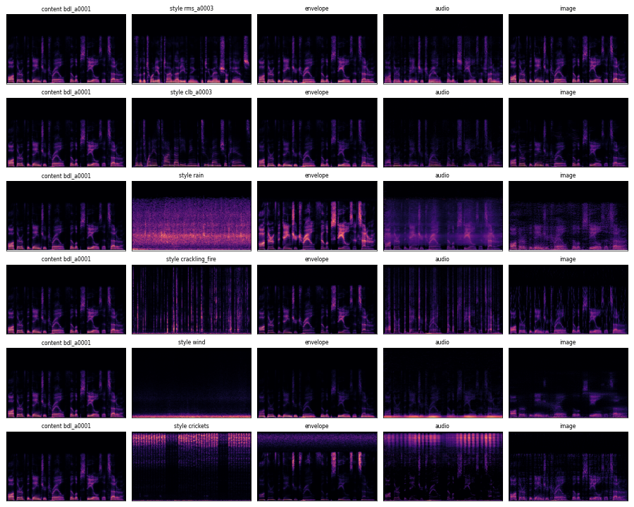

# Audio style transfer through spectrograms

A small experiment: what happens if you take image neural style transfer (Gatys et al. 2016), apply it to a
spectrogram, and turn the result back into sound? Which audible properties come from the content clip and which
from the style clip?

Pipeline: mono audio at 22.05 kHz -> log-magnitude STFT (`log1p|STFT|`, n_fft 1024, hop 256) -> optimise the
spectrogram with LBFGS so its features match the content clip and its Gram matrices match the style clip ->
fast Griffin-Lim initialised from the content clip's phase -> audio.

Three ways of doing the "style" part are compared:

- **audio view** (Ulyanov & Lebedev 2016): frequency bins are channels, one 1D conv layer over time with 4096
  random untrained filters (width 11), ReLU. Gram matrix = filter co-activation averaged over time.
- **image view** (Gatys): the spectrogram as a grayscale picture, repeated to 3 channels, through pretrained
  VGG-19. Style from relu1_1..relu5_1, content from relu4_2. Gram averages over time *and* frequency position.
- **envelope baseline**: no network. Multiply the content STFT by (smoothed long-term style spectrum / smoothed
  long-term content spectrum). Plain cross-synthesis-style EQ matching.

Both NST views use the same loss: `s_wt * style + content`, where each term is normalised by the size of its
target (`||G - G_s||^2 / ||G_s||^2`), so the style weight means roughly the same thing in both views.
Initialisation is the content spectrogram (default, as in Grinstein et al. 2018) or noise.

## Files

- `data.py` downloads the preset clips (only the individual files, not whole datasets) into `data/presets/`
- `nst.py` spectrogram, the two feature extractors, losses, optimisation loop, Griffin-Lim
- `exp.py` the experiment: runs the grid, computes metrics, writes `results/`
- `app.py` Gradio demo
- `viz.py` draws the app's animation frames (numpy + PIL) and writes the optional mp4

## Running

```
pip install -r requirements.txt
python data.py          # 39 preset clips, ~65 MB of downloads (kept in data/raw, ignored by git)
python exp.py           # full experiment, ~15 min with a CUDA GPU
python app.py           # http://127.0.0.1:7860 ; add --share for a temporary public (https) link
```

The first image-view run downloads the torchvision VGG-19 weights (~550 MB). The Whisper check in `exp.py`
downloads `openai/whisper-base.en` through `transformers`.

Speed: on a CUDA GPU one 300-step run takes ~5 s (audio view) or ~11 s (image view). On a CPU with 8 threads
it is ~70 s for the audio view and ~4 min for the image view, so on a laptop use ~100 steps for the image view.

## The app

Pick a content clip and a style clip from the presets (15 voice clips from 7 CMU ARCTIC speakers, 16 ESC-50
textures, 8 instrument notes) or record / upload your own, and press Run. The app then animates the whole
pipeline in one panel:

1. audio -> image: a window slides along each waveform while its spectrogram fills in column by column
2. style matching: the output spectrogram moving step by step from its start towards the result, next to the
   top-left 64 x 64 block of the style's Gram matrix and the output's Gram matrix, and the style-loss curve
3. image -> audio: Griffin-Lim iterations, with the output waveform drawn left to right

At the end it shows the three spectrograms, the output audio and one line on what moved (brightness, pitch).
"Save the animation as a video" writes the sequence plus the output audio as an mp4.

Method, starting point, style strength (light / medium / strong / extreme = style weight 10 / 50 / 150 / 1000)
and steps are in the collapsed Settings panel; the defaults are audio view, start from content, medium,
300 steps (100 for the image view on a CPU). A full default run takes ~20 s on a GPU and ~70-90 s on a CPU.

Recorded and uploaded clips go through a 70 Hz high-pass (browser mics often have a DC offset and mains hum,
which after normalising end up dominating the lowest spectrogram rows), then silence is trimmed at 6 dB above
the clip's own noise floor (a fixed 40 dB trim does nothing on a noisy recording), then the first 6 s are kept
and normalised. Browsers only allow the microphone on localhost or https, so use `--share` when opening the app
from another device.

## Experiment

3 content clips (two CMU ARCTIC voices, bdl and slt, plus a church-bell clip) x 6 style clips (two other
voices, rms and clb, and rain, crackling fire, wind, crickets) x {envelope, audio view, image view}, content
init, style weight 100. Plus noise init for bdl x all styles, and a style-weight sweep (1 to 10000) for
bdl + rain. 82 outputs in total.

For every output, compared against the content and the style clip:

- timbre: spectral centroid, bandwidth, flatness, and the distance between mean MFCCs (mel spectrogram floored
  at -60 dB below peak, c0 dropped). `*_toward_style` puts the output on the line between content and style:
  0 = like content, 1 = like style
- pitch: median f0 from `librosa.pyin`
- rhythm: correlation of the onset-strength envelope with the content's
- loudness: correlation of the RMS envelope with the content's
- intelligibility: Whisper base.en transcript of the output vs the transcript of the content, word error rate

Everything is in `results/`: `metrics.csv` (one row per output, including transcripts), `summary.csv` /
`summary.png` (method averages), `grid_*.png` (spectrograms), `noise_init.png`, `sweep.png`, `pitch.png`, and
four short example outputs in `results/examples/`.

Averages over the content-init grid (from `results/summary.csv`):

| style kind | method | MFCC toward style | centroid toward style | onset corr | RMS corr | WER |
|---|---|---|---|---|---|---|
| texture | envelope | 0.68 | 0.87 | 0.97 | 0.55 | 0.06 |
| texture | audio view | 0.79 | 1.00 | 0.74 | 0.44 | 0.27 |
| texture | image view | 0.26 | 0.22 | 0.75 | 0.79 | 0.23 |
| voice | envelope | 0.57 | (unstable) | 0.99 | 0.78 | 0.00 |
| voice | audio view | 0.72 | (unstable) | 0.84 | 0.44 | 0.31 |
| voice | image view | 0.28 | (unstable) | 0.88 | 0.91 | 0.06 |

(The centroid ratio is unstable for voice-to-voice pairs because the two voices have almost the same centroid.)



## Findings

**Audio view (random 1D conv, frequency as channels).** This is the one that actually transfers something. The
time-averaged spectral colour moves almost all the way to the style clip (centroid lands right on the style's,
MFCCs ~0.8 of the way there). Unlike the envelope baseline it also transfers *texture*: rain fills the silences
between words with rain-like noise, fire adds the vertical broadband crackles, crickets add their
high-frequency pulsed band. Words and rhythm mostly survive with content init: Whisper still gets nearly the
whole sentence (WER 0.1-0.5 on 8-9 word sentences, most errors are proper names such as "Whitmore" ->
"with more"), and the onset envelope correlation with the content stays at 0.43-0.91 (mean ~0.75-0.85).

**Pitch is transferred too, which I did not expect.** For voice -> voice the audio view moves the pitch
register to the style speaker's: bdl (132 Hz) with clb as style comes out at 190 Hz (clb is 185 Hz), slt
(174 Hz) with rms as style comes out at 99 Hz (rms is 99 Hz). See `results/pitch.png`. The envelope baseline
and the image view keep the content's f0 exactly. In hindsight this makes sense: each filter sees the whole
spectrum at once, so a filter tuned to a harmonic comb at absolute frequencies is effectively a pitch
detector, and the Gram matrix records which of those fire together on average. So "time-averaged" does not
mean "pitch-free". What is *not* transferred is the intonation contour itself: the output's pitch track is
messy and follows neither clip closely. It does not sound like the target speaker either, more like the
content's words re-synthesised from the style speaker's harmonic "stock".

**Image view (VGG-19 on the spectrogram picture).** With content init it changes very little that you can
hear: MFCCs move only ~0.25-0.3 of the way, centroid ~0.2, loudness envelope and words are kept, pitch is
kept. The style loss plateaus (around 0.03 for rain vs ~0.0005 for the audio view) no matter how high the style
weight goes (see `results/sweep.png`): turning the weight up from 100 to 10000 makes the VGG content features
drift a lot but the audible metrics stay flat. With noise init you can see why: the texture it synthesises has
none of the style's frequency layout (rain gets spread over the whole frequency axis, fire becomes diagonal
streaks, voices become short harmonic blobs at random heights, `results/noise_init.png`). The Gram matrix
averages over frequency position, so "where in frequency" is thrown away. That is exactly the
"frequency is not like image space" problem from Wyse / Huzaifah & Wyse.

**Envelope baseline.** A plain long-term EQ match gets the timbre ~0.6-0.7 of the way and keeps everything else
(onsets 0.97-0.99, WER ~0, pitch exact). It cannot add events (no crackles, no rain grain in the gaps) and
cannot move pitch. So for "make it sound like it was recorded through this colouration" the dumb baseline is
close to the audio view; the audio view only wins where the style has temporal texture, and it costs
intelligibility and the loudness envelope.

**Noise vs content init.** Audio view with noise init still reconstructs the words reasonably (WER 0.1-0.6
except bdl + clb at 1.0) because the random-feature content loss is quite constraining, and the result has even more of the
style's texture. Image view with noise init loses the content entirely (onset corr ~0.1-0.25, Whisper outputs
nonsense; the WER > 1 values in the CSV are Whisper hallucinating repeated phrases).

**Style weight.** For the audio view, style weight 10-100 is the useful range. Above ~300 the loudness envelope
of the speech is destroyed (RMS corr drops from 0.7 to ~0) and by 10000 the words are gone (WER 1.0). The
MFCC "toward style" score even goes back down there because the output overshoots the style's brightness.

**Checking my hypotheses:**

- *Gram matching mostly transfers time-averaged spectral colour and texture, not pitch, words or rhythm.*
  Mostly true for colour, texture, words and rhythm, but false for pitch register in the audio view.
- *Audio view behaves like timbre transfer.* Yes, plus texture and pitch register.
- *Image view moves patterns around in pitch and creates artifacts.* Yes with noise init. With content init it
  mostly just fails to move far from the content.
- *Content init keeps words and rhythm, noise init gives texture.* Yes for the image view. The audio view keeps
  a surprising amount of the words even from noise.

**Limitations.** Very small sample (2 voices, 1 non-speech content clip, 6 styles, one seed). Phase is not
modelled at all: Griffin-Lim from the content phase works fine when the output is close to the content, but for
large changes there is audible phasiness / metallic smearing that is an artifact of inversion, not of style
transfer. The metrics are rough proxies; pyin gets confused by noisy outputs, Whisper hallucinates on noise, and
WER on 8-word sentences is coarse. One STFT setting only (n_fft 1024, hop 256); no CQT or mel comparison. I did
not run listening tests beyond my own ears.

**Changes from the plan.**

- I used LBFGS instead of Adam. With Adam, every bin moves by about the learning rate each step even when its
  gradient is tiny, so silent regions got a faint noise floor. That made even a style weight of 1 look like a
  big timbre change in the metrics. LBFGS scales steps by the gradient, reaches lower losses (image view rain
  texture 0.027 vs 0.056), and still streams fine in the app because it yields every 10 iterations.
- The MFCC distance is computed with a -60 dB floor for the same reason: without a floor, near-silent
  frames dominate the MFCC means.
- I skipped the instrument presets, because the only NSynth download is a ~300 MB tarball.

## Credits and licenses

- CMU ARCTIC speech databases (Kominek & Black, Carnegie Mellon University), free to use with attribution.
  Speakers bdl, slt, rms, clb, awb, jmk, ksp. http://festvox.org/cmu_arctic/
- ESC-50 (Piczak 2015), clips from Freesound, CC BY-NC 3.0. https://github.com/karolpiczak/ESC-50
  The exact clips used are listed in `data/presets/presets.json`.
- University of Iowa Musical Instrument Samples (Lawrence Fritts), "may be downloaded and used for any
  projects, without restrictions". https://theremin.music.uiowa.edu/MIS.html
- VGG-19 ImageNet weights from torchvision. Whisper base.en from OpenAI via Hugging Face.

References: Gatys, Ecker & Bethge (CVPR 2016); Ulyanov & Lebedev, "Audio texture synthesis and style transfer"
(blog, 2016); Grinstein et al., "Audio style transfer" (ICASSP 2018); Wyse (2017); Huzaifah & Wyse (2019);
Verma & Smith (2018); Perraudin et al., "A fast Griffin-Lim algorithm" (2013).
